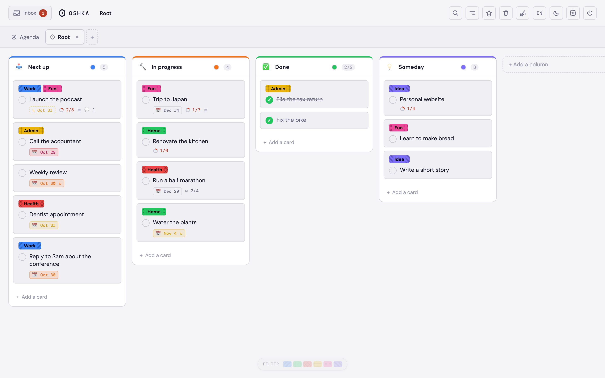
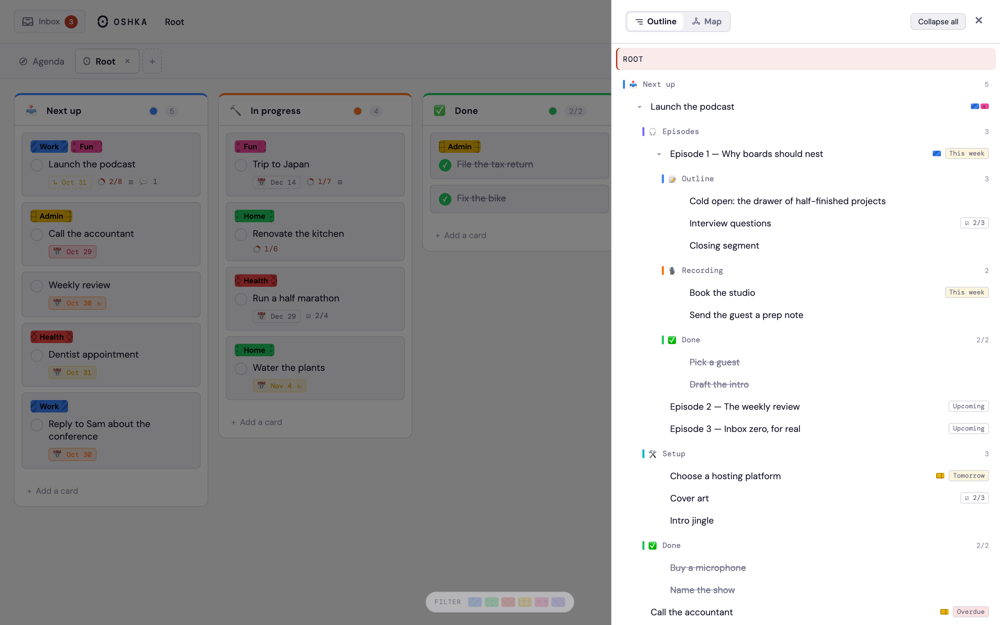
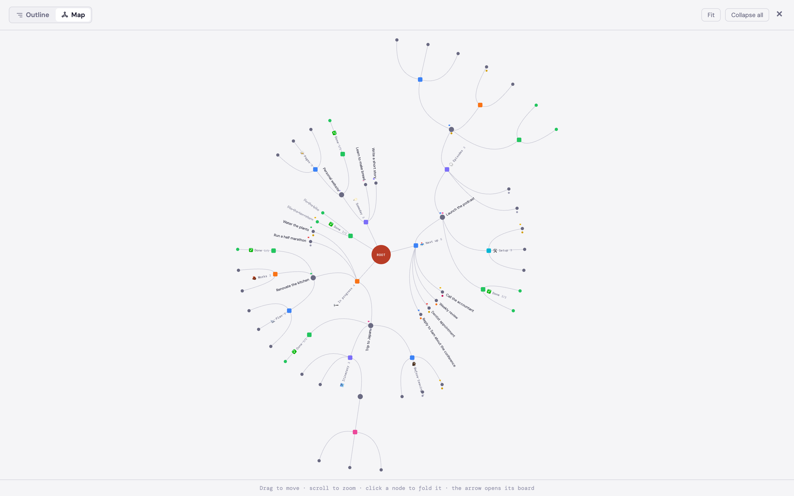
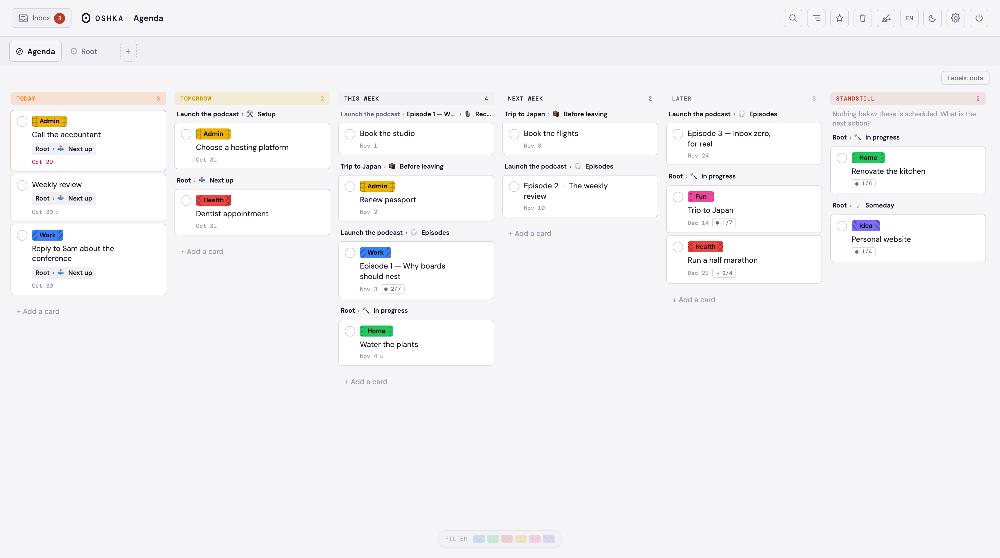
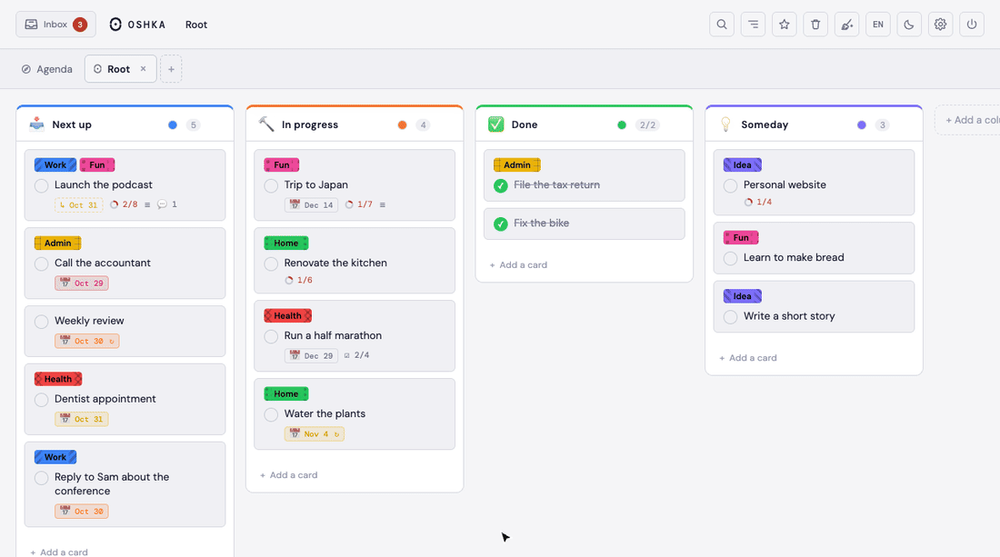

<div align="center">

# Oshka

**Boards inside boards.**

A kanban where every card holds a whole board of its own, to any depth.

</div>

<picture>
  <source media="(prefers-color-scheme: dark)" srcset="docs/media/demo-nesting-dark.gif">
  
</picture>

---

## The idea

A classic board stops at two levels: columns and cards. When a card grows into
a project, you have to create a board for it somewhere else, and the link
between the two only lives in your head.

Here, **a card *is* a board**. Open it and it has its own columns and cards,
which have theirs. The same gesture notes a task and opens a project, because
they are the same thing seen from closer or further away.

Hence the name — *matryoshka*, the Russian doll. The logo is an O that opens
along a seam, and the loading animation shows it: the shell parts, the dot in
the middle grows and becomes the next doll.

## The trap, and the answer

A bottomless tree ends up swallowing everything: you file a lot and find
nothing again. Four views answer that, each one a different question.

| View | Answers | Where |
|---|---|---|
| **Board** | *what is in here?* | the default view |
| **Outline** | *what is underneath?* | the whole tree, collapsible |
| **Map** | *what shape does it all have?* | a radial mind map, root in the middle |
| **Agenda** | *what do I do now?* | the whole tree read as a calendar |

<table>
  <tr>
    <td width="50%"><picture>
  <source media="(prefers-color-scheme: dark)" srcset="docs/media/board-dark.png">
  
</picture><br><sub><b>Board</b> — what is in here?</sub></td>
    <td width="50%"><picture>
  <source media="(prefers-color-scheme: dark)" srcset="docs/media/outline-dark.png">
  
</picture><br><sub><b>Outline</b> — what is underneath?</sub></td>
  </tr>
  <tr>
    <td width="50%"><picture>
  <source media="(prefers-color-scheme: dark)" srcset="docs/media/map-dark.png">
  
</picture><br><sub><b>Map</b> — what shape does it all have?</sub></td>
    <td width="50%"><picture>
  <source media="(prefers-color-scheme: dark)" srcset="docs/media/agenda-dark.png">
  
</picture><br><sub><b>Agenda</b> — what do I do now?</sub></td>
  </tr>
</table>

**Agenda** is the one that tips the tool over. It gathers cards from every
board by due date — today, tomorrow, this week, next week, later — and makes
them draggable: dropping a card in a lane writes its date.

<picture>
  <source media="(prefers-color-scheme: dark)" srcset="docs/media/demo-agenda-dark.gif">
  
</picture>

Its last column does not list undated cards: that would be almost the whole
tree. It lists branches at a **standstill** — a card whose board has a ✅ column and
where nothing, anywhere below, is in progress. Those are the ones that deserve
a "so what is the next action?".

## What it does

**On a card** — Markdown description, comments, labels shared across the whole
tree, due date, repetition, checklists, done state, archiving, duplication,
moving to any other board.

A card can come back every *x* days, weeks or months — the box sits under the
due date, because repetition is not another idea: it is what that date does
next. And a repeating card is never done: ticking it moves it to its next
occurrence and unticks its checklists. To end the series, remove the
repetition.

**On a board** — coloured, named columns, drag and drop for cards and columns,
sorting, label filter, starter templates, trash with restore, undo/redo.

**Everywhere** — search across the whole tree, quick access, tabs to keep
several boards open, light/dark theme, French and English, and real offline
mode: writes are queued and sent again when the network comes back.

**Inbox** — capture now, file later. A note typed into the Inbox, shared from
your phone, sent from Gmail or Slack or added by an assistant waits there until
you drag it onto a board.

<picture>
  <source media="(prefers-color-scheme: dark)" srcset="docs/media/demo-inbox-dark.gif">
  
</picture>

**Conventions** — a column marked ✅ flags a board meant to progress. A card
dropped there becomes done, and a board without that column is never flagged as
stalled: a database or a brainstorming grid has no final state, so it cannot
fall behind on it.

## Shortcuts

On the hovered card, without opening anything:

| Key | Action |
|---|---|
| `R` | rename |
| `E` | labels |
| `D` | due date |
| `A` | archive |
| `M` | move to another column |

And elsewhere: `⌘K` or `/` to search, `⌘Z` / `⇧⌘Z` to undo and redo, `⌥1`…`⌥9`
to switch tabs. A click on a card opens it, a double click enters its board.

## Share a link from your phone

**iPhone / iPad** — In Oshka, open **Settings → Connections & sharing →
iPhone / iPad**, then install the **Ajouter à Oshka** shortcut. Open the
downloaded file from Safari Downloads or the Files app to add it to Shortcuts.
Just tap the link: a long press shows a preview. Then, in Safari or another
app: **Share → Ajouter à Oshka → Add to Inbox**. The shortcut opens Oshka in
the browser; you may need to sign in once, even if the app is already on your
home screen.

**Android** — Install Oshka from the Chrome menu. From another app, choose
**Share → Oshka**, check the card and add it to the Inbox. If the app was
installed before this feature, let Chrome update it or reinstall it; your cards
stay in your account.

Title and content can be edited before adding. A pending share is kept while
you sign in; cancelling creates no card. Adding is a single undoable operation.
Photos and attached files are not supported by this flow.

The signed shortcut is not versioned: generate and sign it on a Mac, into
`public/shortcuts/`, before deploying Hosting:

```bash
python3 scripts/build-share-shortcut.py /tmp/oshka-unsigned.shortcut
shortcuts sign --mode anyone --input /tmp/oshka-unsigned.shortcut --output public/shortcuts/Ajouter-a-Oshka.shortcut
```

The script reads the instance origin from `OSHKA_ORIGIN` (`.env`) or from its
second argument. Public signing has Apple validate the file, without including
any Oshka account or token.

The input of the URL Encode action must be a `WFTextTokenString` holding the
`ExtensionInput` token. A `WFTextTokenAttachment` placed directly in that
parameter is dropped by Apple on import: the shortcut runs but only opens
`/share#text=`, with no link. This was reproduced in the Shortcuts engine on
Mac with a URL as input. After fixing the file, the shortcut installed on the
iPhone must be replaced; it does not update with the site. An empty share now
shows a message and lets you paste the link.

The download must keep its `.shortcut` extension and be served as an attachment
(`Content-Disposition: attachment`). Without that header, Safari's preview
showed the signed file as plain text. The service worker leaves these downloads
to the browser. HTTP check against the Hosting emulator or after deploying:

```bash
node scripts/check-share-download.mjs https://<project>.web.app
```

## Gmail

The Oshka Gmail add-on works on iPhone and Mac: opening Oshka on an email
creates a card straight away, with a link back to the source. Every email you
view while the panel stays open is added too; close the panel to stop. Private
installation and connection: [Gmail guide](docs/GMAIL.md).

## From Slack

A Slack app adds **Add to Oshka** to a message's menu: confirm the title and
the text is saved with its link in the Inbox. Setting up the workspace, the two
secrets and the personal link is described in [docs/SLACK.md](docs/SLACK.md).

## From Claude or Codex

An MCP server gives an assistant access to your boards: read the tree and the
agenda, search, capture into the Inbox, create, move, complete, comment.
Sign-in goes through your Oshka account.

| Client | How to connect it |
|---|---|
| **claude.ai** (web, then mobile) | Settings → Connectors → *Add custom connector* → `https://<project>.web.app/mcp` |
| **Claude Code** | `claude mcp add --transport http oshka https://<project>.web.app/mcp`, then `/mcp` to sign in |
| **Codex** | `codex mcp add oshka --url https://<project>.web.app/mcp`, then `codex mcp login oshka` |

A connector added on claude.ai follows the account: it is then available in the
mobile app. How it works is described in
[docs/ARCHITECTURE.md](docs/ARCHITECTURE.md#the-mcp-server).

## Getting started

```bash
npm install
```

Copy `.env.example` to `.env` and fill in the values from the Firebase console
(Project settings → Your apps), then link the folder to your Firebase project:

```bash
cp .env.example .env
firebase use --add
```

`authDomain` and `storageBucket` are derived from the project ID in
`src/lib/firebase.js`. These values are public by nature: security comes from
the Firestore rules, not from keeping them secret. On the Cloud Functions side,
the origin defaults to `https://<project>.web.app`; for a custom domain, set
`OSHKA_ORIGIN` in `functions/.env`.

```bash
npm run dev
```

| Command | |
|---|---|
| `npm run dev` | development server |
| `npm test` | the test suite |
| `npm run test:watch` | tests in watch mode |
| `npm run lint` | ESLint |
| `npm run build` | production build |
| `firebase deploy --only hosting` | deploy the app |
| `firebase deploy --only functions:mcp,hosting,firestore` | deploy the MCP server (and the rewrites that serve it) |
| `npm run seed:local` | test account and board in the emulators |

### Testing without touching production

The `dev-local` launch configuration (`.claude/launch.json`) starts the Auth
and Firestore emulators and serves the app on **`localhost:5174`** with
`VITE_EMULATORS=1`. The app then points at a `demo-oshka` project, which does
not exist on Firebase: nothing can reach the real database, even by mistake.
The different port also keeps browser storage apart from production's.

The emulators keep everything in memory: each launch starts from scratch, so it
first recreates the test account and a sample board (credentials are in
`scripts/seed-emulator.mjs`). To reset the board without relaunching:

```bash
npm run seed:local
```

A test bench for the logo animation is available at **`/loader`** in
development only — it plays it in a loop, slowed down, frame by frame.

## Under the hood

React 19, Vite, Firebase (Auth + Firestore), `@hello-pangea/dnd` for drag and
drop. No styling framework: a single CSS sheet, built on theme variables.

```
src/
├── components/   views and panels
├── hooks/        useBoard (state and sync), useTabs, useAuth…
├── lib/          pure logic — and that is where the tests are
└── styles/       app.css
```

**Business logic lives in `src/lib`, as pure functions**, separate from
rendering: moving a card between boards, slicing the Agenda, the radial layout of
the mind map, search. That is what is tested.

For the why behind the decisions — the data model, synchronisation, the traps
we hit — see **[docs/ARCHITECTURE.md](docs/ARCHITECTURE.md)**.

## License

[MIT](LICENSE)
